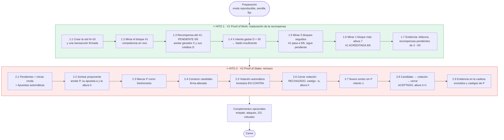
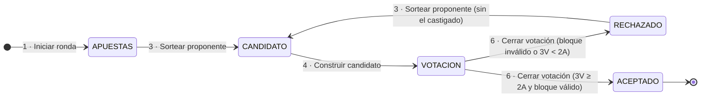

# Guía rápida para la demostración del video (Sellalo)

Cheat sheet para grabar la demo paso a paso. Los textos **en negritas** son los botones, campos o columnas exactos de la app.

## Los dos hitos que pide el entregable

La guía del proyecto (sección 7, punto 4) pide un video que muestre ambas versiones, **un rechazo en PoS** y **la maduración de una recompensa en PoW**. Estos dos son los únicos escenarios que exige por nombre, así que la demo gira alrededor de ellos.

| Hito | Qué dice la guía | Qué significa | Qué tiene que verse en el video |
|---|---|---|---|
| **1. Maduración de una recompensa (PoW)** | §3.6: *la recompensa del bloque de altura h queda pendiente y se acredita al saldo del ganador cuando la cadena alcanza la altura h + 6. La interfaz distingue saldo disponible y recompensas pendientes.* | Ganar un bloque no da créditos de inmediato. La recompensa queda "congelada" hasta que se minan 6 bloques encima, igual que en Bitcoin, porque un bloque reciente aún podría ser reemplazado. | 1) Un laboratorio gana el bloque *h* y su recompensa aparece **pendiente**. 2) **No la puede gastar** todavía. 3) Las confirmaciones suben de 0/6 a 5/6. 4) Al llegar a la altura *h + 6* pasa a **acreditada** y sí forma parte de sus créditos. |
| **2. Rechazo en PoS** | §4.7: *si se rechaza, el proponente pierde su apuesta completa o un porcentaje… y se repite el sorteo con los validadores restantes.* Y: *la aplicación debe permitir marcar un nodo como deshonesto… los validadores honestos votan en contra.* | El proponente sorteado presenta un bloque inválido, los validadores lo revisan y no llega a 2/3 de los votos. El bloque **no entra a la cadena**, el proponente **es castigado** y se **sortea de nuevo** sin él. | 1) Un laboratorio **deshonesto** sale sorteado. 2) Los honestos **votan en contra** con un motivo visible. 3) Resultado **RECHAZADO**: la altura no cambia. 4) **Castigo** aplicado. 5) **Nuevo sorteo** sin el castigado y bloque **ACEPTADO**. 6) El castigo queda registrado en la cadena. |

---

## Diagrama de flujo de la demo

---

## Preparación (antes de grabar)

- [ ] `flask run` → **http://127.0.0.1:5000**. Zoom del navegador al 90–110 %.
- [ ] En **V1 · Proof of Work** y en **V2 · Proof of Stake**: marcar **Modo reproducible**, semilla `2026`, **Laboratorios (N)** `10` → **Crear / reiniciar simulación**.
- [ ] Ensayar una vez completo con esa semilla: el ganador y el proponente saldrán iguales al grabar.
- [ ] Tener a mano esta tabla para anotar los valores durante la grabación:

| Hito 1 (PoW) | Valor | Hito 2 (PoS) | Valor |
|---|---|---|---|
| Ganador del bloque #1 (**X**) | | Proponente sorteado (**P**) | |
| **Créditos disponibles** de X (**D**) | | **Apuesta** de P (**a**) | |
| | | **Créditos** de P antes (**C**) | |
| | | Altura antes de la ronda (**h**) | |

---

## ⭐ HITO 1 · Maduración de una recompensa (V1 · Proof of Work)

Regla en una frase: *la recompensa del bloque h se acredita cuando la cadena llega a h + 6.* El bloque #1 madura en la **altura 7**.

| # | Acción en la UI | Qué decir o señalar | Evidencia en pantalla ✔ |
|---|---|---|---|
| 1.1 | **Laboratorio emisor** `N00`, **Laboratorio receptor** `N01`, **Créditos** `10` → **Firmar y enviar** | Toda transacción va firmada; la red verifica la firma | Aparece en **Pendientes** |
| 1.2 | **Dificultad (ceros)** `4`, **Bloques seguidos** `1`, ☑ **Generar transacciones automáticas si faltan** → **Iniciar minado** | Competencia en vivo: nonces disjuntos (N00 prueba 0, 10, 20…; N01 prueba 1, 11, 21…). Al haber ganador, todos se detienen | Una tarjeta en *ganador* y las demás en *detenido*; barra superior con **altura 1** |
| 1.3 | Ir a **Recompensas** (sección 6) y a **Estado de cada laboratorio** | La recompensa existe pero **todavía no es suya** | **Recompensas**: `#1 · X · 50 · 0/6 · pendiente`. Estado: X tiene `50 pendiente` en **Recompensas pendientes**. Anotar **X** y sus **Créditos disponibles** (**D**) |
| 1.4 | **Laboratorio emisor** = X, **Créditos** = **D + 50** → **Firmar y enviar** | *Recompensa consultada antes de 6 confirmaciones:* no se puede gastar | Aviso rojo: *Saldo insuficiente: X tiene D disponible e intenta enviar D+50* |
| 1.5 | **Dificultad (ceros)** `3`, **Bloques seguidos** `5` → **Iniciar minado** | Cada bloque nuevo es una confirmación más | **Recompensas**: el #1 sube 1/6 → … → **5/6** y **sigue pendiente**; barra en **altura 6** |
| 1.6 | **Bloques seguidos** `1` → **Iniciar minado** | Con la altura 7 se cumple h + 6 = 1 + 6 | **Recompensas**: `#1 · X · 50 · 6/6 · acreditada` (verde); barra en **altura 7** |
| 1.7 | Señalar la **Bitácora** y el **Estado de cada laboratorio** | La recompensa pasó de pendiente a disponible | Bitácora: *Recompensa del bloque #1 (50) acreditada a X tras 6 confirmaciones (altura 7).* En X, **Recompensas pendientes** bajó 50 y sus **Créditos disponibles** subieron 50 (salvo que X haya enviado o recibido transacciones automáticas) |

**Variante rápida (o para reforzar):** **Minar 10 bloques seguidos** desde la altura 0. Al terminar se ven acreditadas las recompensas #1–#4 y pendientes las #5–#10 con 5/6, 4/6… Esto cubre además el requisito de *minar al menos 10 bloques seguidos*.

---

## ⭐ HITO 2 · Rechazo en PoS (V2 · Proof of Stake)

Regla en una frase: *si el bloque no reúne 2/3 de los votos ponderados (o es inválido), no entra a la cadena, el proponente pierde su apuesta (regla A) y se sortea otro sin él.*

Antes de empezar: **Regla de castigo** = *A · c = apuesta completa*, **Fraude del laboratorio deshonesto** = *Firma alterada*, **Tamaño del comité** `0` → **Guardar configuración**.

| # | Acción en la UI | Qué decir o señalar | Evidencia en pantalla ✔ |
|---|---|---|---|
| 2.1 | **Generar 3 aleatorias** → **1 · Iniciar ronda** → **2 · Apuestas automáticas** | Comité de validadores; cada apuesta queda bloqueada | Etapa **APUESTAS**; columnas **Apuesta** y **Probabilidad** (aᵢ / A) |
| 2.2 | **3 · Sortear proponente** | Sorteo ponderado con semilla pública `hash_anterior\|número\|intento` | Etapa **CANDIDATO**; un laboratorio con papel *proponente*. Anotar **P**, su **Apuesta** (**a**), sus **Créditos** en el Estado (**C**) y la **altura h** de la barra superior |
| 2.3 | En **Estado de cada laboratorio**, columna **Comportamiento**: pulsar **Honesto** en P | P se vuelve deshonesto: propondrá un bloque con una firma alterada | El botón de P cambia a **Deshonesto** (rojo) |
| 2.4 | **4 · Construir candidato** | P arma y firma su bloque, pero alteró la firma de una transacción | Etapa **VOTACION**; recuadro *Bloque candidato #h+1 · proponente P · intento 0* |
| 2.5 | **5 · Votación automática** | Cada validador honesto revisa el bloque contra **su propia copia** de la cadena y vota en contra; P vota a favor | En la columna **Voto**, los honestos dicen *en contra* con el motivo *transacción 1: firma inválida…*. La barra de votos queda **por debajo** de la marca de 2/3 |
| 2.6 | **6 · Cerrar votación** | **El rechazo:** el bloque no entra, P pierde toda su apuesta (regla A) y queda fuera de la ronda | Etapa **RECHAZADO** (roja). Mensaje: *Bloque de P rechazado; castigo de a. Repite el sorteo con los … validadores restantes.* P aparece como *castigado (−a)* y la barra sigue en **altura h**. Bitácora: entrada **castigo** |
| 2.7 | **3 · Sortear proponente** | Se repite el sorteo **sólo con los restantes** (intento 1) | P sin probabilidad (—); nuevo proponente ≠ P |
| 2.8 | **4 · Construir candidato** → **5 · Votación automática** → **6 · Cerrar votación** | Ahora el bloque es válido y todos votan a favor | Etapa **ACEPTADO** (verde); barra en **altura h+1**; *Recompensa de 10 pagada…*; **Intentos de esta ronda**: `Intento 0 · P: RECHAZADO` y `Intento 1 · …: ACEPTADO` |
| 2.9 | **5 · Cadena de bloques** → último bloque → abrir **Votos** y **castigo(s) registrados** | El castigo queda en la cadena y cualquier nodo lo puede verificar | *Votos: … · intento 1*, *Excluidos por rechazo: P*, *P: −a (regla A, apuesta a)*. En el Estado, los **Créditos** de P ahora son **C − a** (más o menos lo que P envió o recibió en ese bloque) |

**Variantes del rechazo (opcionales):**
- **Con la regla B:** antes de 2.1 elegir *B · c = min(apuesta, α · valor de las tx)* con **α (%)** `50`. El castigo será menor: el 50 % del valor de las transacciones del candidato, sin pasar de la apuesta.
- **Por votos y no por fraude:** con un proponente honesto, en 2.5 pulsar **En contra** a mano en la mayoría de los validadores en vez de **5 · Votación automática**. Al cerrar: *votos insuficientes … (se requieren al menos 2/3)*.

---

## Complementos opcionales (si sobra tiempo)

Estos escenarios no son obligatorios en el video, pero suman a "muestran todos los escenarios pedidos" de la rúbrica.

| Escenario | Cómo mostrarlo | Evidencia |
|---|---|---|
| Empate en la misma ronda (PoW) | **Dificultad (ceros)** `1` → **Iniciar minado** | *Empate en la ronda… gana N0X por tener el hash menor* |
| Ataques a la cadena | Con la dificultad en 1, en **Casos de prueba y ataques**: **Bloque con hash alterado**, **Manipular un bloque intermedio**, **Bloque con recompensa falsa**, **Cadena más corta** | *Los 9/9 nodos la rechazaron* + motivo |
| Ataques a transacciones | **Transacción con firma alterada**, **Transacción firmada con la clave de otro nodo**, **Gastar dos veces el mismo saldo** | *firma inválida* / *Saldo insuficiente* |
| Votación exactamente en 2/3 (PoS) | Regresar P a **Honesto**. **Tamaño del comité** `3` → **Guardar configuración** → **1 · Iniciar ronda** → **Apostar** `10` en cada validador → **3 · Sortear proponente** → **4 · Construir candidato** → **A favor**, **A favor**, **En contra** → **6 · Cerrar votación** | Barra en 66.7 % → **ACEPTADO** |
| Votos falsos en un bloque (PoS) | **Voto de un nodo que no es validador**, **Un validador vota dos veces** | Rechazado con su motivo |
| Límite de rondas (PoW) | **Dificultad** `6`, **Nonces por minero y ronda (k)** `10`, **Límite de rondas** `20` → **Iniciar minado** | *Se alcanzó el límite de 20 rondas…* |
| Robustez | Recargar la página (F5) a mitad del minado; correr `pytest` en la terminal | El estado sigue igual; **174 passed** |

---

## Si algo sale mal durante la grabación

| Situación | Solución |
|---|---|
| *No hay transacciones pendientes* al iniciar una ronda PoS | **Generar 3 aleatorias** |
| En 2.2 no te convence el proponente sorteado | No importa quién salga: marca a **ese** como deshonesto. Si ya lo marcaste tarde, **Cancelar ronda** y repite desde 2.1 |
| En 2.5 no salen votos en contra | P no quedó marcado como **Deshonesto** antes de 2.4: **Cancelar ronda**, márcalo y repite |
| **1 · Iniciar ronda** está deshabilitado | Hay una ronda en curso: termínala o pulsa **Cancelar ronda** |
| El minado tarda demasiado | **Cancelar** y bajar la dificultad a 3 |
| En 1.4 el aviso no es de saldo insuficiente | Revisa que **Laboratorio emisor** sea X y que el monto sea **D + 50**, con D tomado de **Créditos disponibles** |
| El estado quedó desordenado | **Crear / reiniciar simulación** en esa pestaña y empieza ese hito de nuevo |
